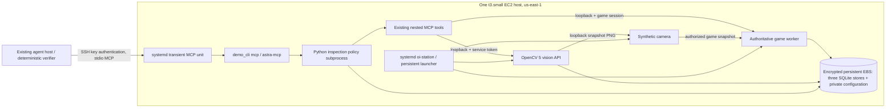

# Demonstrate the persistent inspection station on AWS

This deploys the **existing game runtime + synthetic camera + Python OpenCV 5
inspection station**, not the work-cell runtime. No GPU, public HTTP API, model
account, DNS, TLS proxy, or Kubernetes is required. An external agent uses SSH stdio
to the same MCP entry point tested locally.

**Deployment status:** deployed through the official AWS MCP server on 2026-10-27 UTC,
instance `i-0fc59dacd62a60f0a` in `us-east-1`. The deterministic inspection loop,
service restart and actual host reboot passed. See the [AWS evidence](evidence/aws-inspection-live/README.md).
No model-driven run is claimed. AWS access used browser OAuth through
`https://aws-mcp.us-east-1.api.aws/mcp`; local CLI credentials were not required.
The CLI provisioning recipe below is an alternative using the same CloudFormation template.
The [retained local evidence](evidence/aws-inspection-local/README.md) contains actual
MCP traces, before/after images, launcher restart and complete-state restore results.

## Architecture and ownership



- **Perception:** actual OpenCV processing of synthetic pixels.
- **Decision:** deterministic bounded policy gates one operator-configured survey.
- **Action:** authorized **simulated** movement by the real game worker. Marker image
  coordinates are not robot coordinates. No physical motion is verified.
- **Model-driven agent:** optional external MCP client; its existing provider/model
  configuration stays on the user's machine. Deployment never copies provider secrets.

| Item | Selected configuration |
| --- | --- |
| Region | `us-east-1` (N. Virginia) |
| Compute | Linux On-Demand `t3.small`, 2 vCPU / 2 GiB, CPU-only, Unlimited CPU credits (see surcharge below) |
| OS | Canonical Ubuntu Server 24.04 amd64; resolve once, save and deploy the exact AMI ID |
| Storage | 30 GiB encrypted gp3 root EBS, including private state outside the checkout; `DeleteOnTermination=false` |
| Application | Full 40-character commit from **Mapped-Assembly/Open-Industries** |
| Node | 22.23.4 official binary with checked SHA-256 (meets 22.18+ launcher requirement) |
| Python | Ubuntu's Python 3.12, exact patch version recorded in evidence |
| Dependencies | `npm ci` using `package-lock.json`; hash-pinned CPython 3.12 Linux wheels in `deploy/inspection/requirements.lock`; application installed from pinned commit |
| App path | `/opt/oi-station/app` (real directory, **not** a changing release symlink) |
| Runtime | `/opt/oi-station/node`, `/opt/oi-station/venv`; root-owned |
| Service identity | `oi-station`, system account, no login shell |
| Complete state | `/var/lib/oi-station/state`, mode 0700; private config 0600 |
| Logs | systemd journal namespace `oi-station`, 100 MiB / 14-day bound |
| Ingress | TCP 22 from a required operator IPv4 `/32`, nothing else |
| AWS privileges on VM | None: no instance profile; IMDSv2 required for identity only |

The AMI and application dependencies are pinned. Ubuntu security packages are installed
from the current Ubuntu repository, not a byte-identical OS snapshot; retain the AMI ID
and `dpkg-query -W` privately if exact OS patch reproduction is required. No Free Tier
eligibility is assumed for other accounts. The initial Standard-credit deployment
throttled with an empty CPU-credit balance. The observed station uses Unlimited;
the template's `CpuCredits` parameter defaults to this measured configuration.
Standard remains selectable but has not passed this deployment's acceptance workload.

## Operating cost (checked 2026-10-27 UTC)

The official [regional EC2 price list](https://pricing.us-east-1.amazonaws.com/offers/v1.0/aws/AmazonEC2/current/us-east-1/index.csv)
reported effective date 2026-10-01:

| Resource | Rate | 730-hour estimate |
| --- | --- | --- |
| Linux shared On-Demand t3.small, SKU `QA3NBPZEQKZ2K9AR` | $0.0208/hour | $15.18 |
| gp3 storage, SKU `JG3KUJMBRGHV3N8G` | $0.08/GB-month × 30 GB | $2.40 |
| One public IPv4 | $0.005/hour | $3.65 |
| **Base total** | **Before credits and surplus CPU** | **about $21.24/month** |

Linux T3 Unlimited surplus CPU costs **$0.05/vCPU-hour** above the earned baseline,
subject to AWS's credit accounting. A short post-reboot idle sample measured about
25–32% aggregate CPU versus the 20% baseline, suggesting roughly **$25–30/month**
including base resources if sustained. Inspections and startup used more CPU. This is
not a long-duration billing measurement. At sustained 100% CPU, the compute-credit
surcharge can reach $58.40/730-hour month, for about **$79.64/month total** before
other exclusions. Monitor `CPUCreditBalance`, `CPUSurplusCreditBalance`, and
`CPUSurplusCreditsCharged`; the original $21.24 estimate alone is insufficient.

AWS `GetAccountPlanState` confirmed the deployment account has an **active Free plan
and $100 remaining credits**, with plan expiration **2027-04-16** at the time checked.
Eligible usage consumes those credits; the figures above are gross usage estimates,
not an immediate cash bill. Other resources and workloads also draw from the balance.

Sources: [T3 specifications](https://aws.amazon.com/ec2/instance-types/t3/),
[EBS pricing](https://aws.amazon.com/ebs/pricing/),
[IPv4 pricing](https://aws.amazon.com/vpc/pricing/), and
[observed price record](../deploy/inspection/pricing-observed.json). The marketing T3
table rounded differently ($0.0209); the estimate uses the regional On-Demand SKU.
Recheck prices before provisioning. Taxes, egress, snapshots/off-host storage and any
optional model API usage are additional. There is no NAT gateway or Elastic IP here.

Stopping EC2 stops compute charges and releases its auto-assigned public IPv4; the IP
can change on start. **EBS keeps charging while stopped and after termination** until
explicitly deleted. Snapshots and off-host backups keep charging until deleted, and
any separately allocated Elastic IP keeps charging even while idle.

## Provision from your workstation

Requirements: authorized AWS CLI credentials (existing profile/SSO/role), EC2 quota,
permission for CloudFormation, VPC/subnet/routes/security groups, EC2/EBS/tags and
`ssm:GetParameter` for the public Canonical AMI parameter. No IAM resource creation is
required. Reuse your existing SSH key pair or import its **public** key. Do not paste
AWS keys, station credentials or model tokens into this repository or user-data.

From the reviewed branch/commit:

```bash
export AWS_REGION=us-east-1
# Set AWS_PROFILE only if needed for your existing authorized profile.
aws sts get-caller-identity
export OI_RELEASE=$(git rev-parse HEAD)  # must be a reviewed commit pushed to Mapped-Assembly
export OI_KEY_NAME=oi-inspection-operator
export OI_ADMIN_CIDR='YOUR.PUBLIC.IP.ADDRESS/32'
export OI_AMI=$(aws ssm get-parameter \
  --name /aws/service/canonical/ubuntu/server/24.04/stable/current/amd64/hvm/ebs-gp3/ami-id \
  --query Parameter.Value --output text)
aws ec2 describe-images --image-ids "$OI_AMI" \
  --query 'Images[].{Id:ImageId,Owner:OwnerId,Name:Name,Architecture:Architecture}'
# Require Canonical owner 099720109477, Ubuntu 24.04 server and x86_64.
# Only if that named key is not already imported:
aws ec2 import-key-pair --key-name "$OI_KEY_NAME" --public-key-material fileb://"$HOME/.ssh/id_ed25519.pub"
mkdir -p .astra/inspection-provision
python3 - <<'PY'
import json, os
mapping = {'Release':'OI_RELEASE','ImageId':'OI_AMI','KeyName':'OI_KEY_NAME','AdminCidr':'OI_ADMIN_CIDR'}
with open('.astra/inspection-provision/parameters.json', 'w') as f:
    json.dump([{'ParameterKey': k, 'ParameterValue': os.environ[v]} for k,v in mapping.items()], f, indent=2)
PY
aws cloudformation validate-template --template-body file://deploy/inspection/station.cfn.json
aws cloudformation create-stack --stack-name oi-inspection \
  --template-body file://deploy/inspection/station.cfn.json \
  --parameters file://.astra/inspection-provision/parameters.json
aws cloudformation wait stack-create-complete --stack-name oi-inspection
aws cloudformation describe-stacks --stack-name oi-inspection \
  --query 'Stacks[0].Outputs' > .astra/inspection-provision/outputs.json
cat .astra/inspection-provision/outputs.json
```

The template creates one dedicated VPC/subnet and instance. Cloud-init installs the
exact commit and dependencies, then enables the services. Stack completion proves
infrastructure creation only; inspect `cloud-init status --wait` and live health below.
For provisioning failures, inspect `sudo tail -100 /var/log/cloud-init-output.log`.
Do not replace the instance automatically to fix an app error: the retained disk
contains the station identity. Do not update the stack's `Release` to perform upgrades;
use the fixed-path procedure below.

Save the instance and volume IDs now (also needed for teardown):

```bash
export OI_INSTANCE=$(aws cloudformation describe-stacks --stack-name oi-inspection \
  --query "Stacks[0].Outputs[?OutputKey=='InstanceId'].OutputValue | [0]" --output text)
aws ec2 describe-instances --instance-ids "$OI_INSTANCE" \
  --query 'Reservations[0].Instances[0].{InstanceId:InstanceId,ImageId:ImageId,InstanceType:InstanceType,Placement:Placement,Volumes:BlockDeviceMappings,PublicIp:PublicIpAddress}' \
  > .astra/inspection-provision/instance.json
```

## Authenticated agent access

Verify the SSH host-key fingerprint through a trusted EC2 console/administrative
channel before accepting it. Add an alias to your existing SSH config:

```sshconfig
Host oi-inspection
    HostName REPLACE_WITH_INSTANCE_PUBLIC_IP
    User ubuntu
    IdentityFile ~/.ssh/id_ed25519
    IdentitiesOnly yes
    StrictHostKeyChecking yes
    ServerAliveInterval 30
    ServerAliveCountMax 3
```

After establishing the trusted host-key entry:

```bash
ssh oi-inspection 'cloud-init status --wait'
ssh oi-inspection 'sudo systemctl status oi-station oi-station-health.timer --no-pager'
ssh -T oi-inspection sudo -n /usr/local/bin/oi-station-mcp
```

The last command is a **stdio MCP server**, not an interactive shell. Supply it to
your existing MCP-capable agent host using [mcp.example.json](../deploy/inspection/mcp.example.json).
Merge the entry only; preserve the user's existing model, provider, tools and secrets.
If the host uses a different configuration schema, copy the command/argument vector
unchanged into its local stdio-server configuration. The installed wrapper emits only
MCP on stdout; SSH/systemd diagnostics go to stderr. Never allocate a TTY (`-T`).

SSH keys authenticate the operator; remote service-owned connection files provide
separate game/vision authorization. No token is embedded in the workstation MCP JSON.
The wrapper runs the MCP host on EC2 in a transient systemd service as `oi-station`,
with `PartOf=oi-station.service`. Stopping the station terminates the MCP policy and
nested transports as well. `Requisite` refuses a connection during downtime instead
of starting a second station. The root-owned wrapper accepts no arguments; its sudoers
entry permits only that exact command. The Ubuntu administrator is already privileged.

On-host agents can use the same wrapper. Session refresh applies to new MCP connections;
reconnect if an old client returns `AUTH_REQUIRED`. Camera/game/vision endpoints remain
loopback-only. There is no HTTP forwarding rule, camera public link, or ingress API port.

## Operation, supervision and recovery

On the host, use these exact paths (no activation of an interactive virtualenv needed):

```bash
export PATH=/opt/oi-station/node/bin:/usr/bin:/bin
PY=/opt/oi-station/venv/bin/python
sudo -u oi-station env PATH="$PATH" "$PY" -m oi_vision.demo_cli status --state-dir /var/lib/oi-station/state
sudo -u oi-station "$PY" -m oi_vision.demo_cli marker hide --state-dir /var/lib/oi-station/state
sudo -u oi-station "$PY" -m oi_vision.demo_cli marker show --state-dir /var/lib/oi-station/state
sudo systemctl restart oi-station
sudo journalctl --namespace=oi-station -u oi-station -u oi-station-health --since '1 hour ago' --no-pager
sudo systemctl show oi-station -p MainPID -p NRestarts -p ControlGroup
sudo ss -ltnp
df -h /var/lib/oi-station
```

`ExecStartPost` waits for live health; the timer probes scheduler heartbeat, vision and
camera every 30 seconds. A timer failure is observable in systemd/journal; no external
alert service is provisioned. Launcher maintenance exits on worker failure. systemd
restarts after 10 seconds, capped at five starts in 300 seconds. After correcting a
persistent problem: `sudo systemctl reset-failed oi-station && sudo systemctl start oi-station`.

`KillMode=mixed` sends SIGTERM to the launcher for orderly HTTP shutdown and SQLite
checkpointing, then kills every remaining cgroup process after 30 seconds. A worker's
`start_new_session` does not escape that cgroup. MCP units use `KillMode=control-group`.
Do not run an additional unsupervised `demo_cli serve` against the installed state.
To verify recovery on EC2, record old PIDs, kill the **main launcher** with
`sudo systemctl kill --kill-whom=main --signal=SIGKILL oi-station`, wait for readiness,
and check that old worker PIDs are gone, there is only one worker, and saved IDs match.
This requires observed host results; local launcher tests do not prove systemd behavior.

## Reproducible acceptance evidence

Use a fresh station for the initial success recording. The robot stays at its survey
destination; the verifier refuses to erase earlier jobs or silently reset a fixture.
For a later manual demonstration, use `return_robot` and wait for its completion,
or provision a separately named station. Do not invent a new UUID for an uncertain action.

Run on EC2 as the administrator; output is private and separate from station state:

```bash
sudo bash /opt/oi-station/app/deploy/inspection/record.sh before-reboot /var/lib/oi-station/submission
# The script exercises marker-hidden review, marker-visible action, same-UUID retry,
# disconnect during an accepted job, reconnect, then service restart and verification.
sudo reboot
# Reconnect once the instance is back; the same output path is required:
sudo bash /opt/oi-station/app/deploy/inspection/record.sh after-reboot /var/lib/oi-station/submission
```

`station_evidence` connects through `/usr/local/bin/oi-station-mcp` in this script.
It records IMDSv2 instance/AMI/type/region, actual Python/Node/OpenCV versions, application
commit, dirty-checkout flag, UTC timestamps, boot ID, health, stable station identity,
sanitized MCP calls, exact inspection checkpoints and before/after JPEG previews.
Preview SHA-256 is distinguished from the retained original PNG SHA-256. No credentials
or raw service configuration are exported. Credential identity is compared by a digest
of the generated high-entropy private identity; renewable session tokens are excluded.

The review case must have two rejected observations, `needs_review`, and no command/job.
The action case must have one accepted survey, a completed runtime job, moved robot,
changed pixels, and identical terminal same-UUID replay. The disconnected client must
reconnect to the same command/job. After restart/reboot, identity/credentials/ports,
terminal records, previews, and the single job must match. `verify --kind reboot`
fails unless the observed boot ID changed; a mere service restart cannot pass it.

Export **only** the following allowlisted files, not the state/backup directory:

```bash
ssh oi-inspection 'sudo tar -C /var/lib/oi-station/submission -cf - exercise.json tool-trace.json before.jpg after.jpg verified-restart.json verified-reboot.json' \
  > .astra/inspection-provision/submission.tar
mkdir -p .astra/inspection-provision/submission
tar -xf .astra/inspection-provision/submission.tar -C .astra/inspection-provision/submission
```

Concise screen-recording storyboard (about two minutes plus the real reboot wait):

1. Show region/type, commit and health, labelling **synthetic camera / simulated robot**.
2. Show hidden-marker `needs_review`, reason and zero jobs in `exercise.json`/tool trace.
3. Show visible-marker initial image, accepted command/job, disconnect/reconnect entries,
   completed job and changed follow-up image. Keep the same run UUID visible.
4. Show terminal retry identity, restart verification, then actual reboot verification
   with changed boot ID and unchanged match/robot/job IDs.
5. State **deterministic MCP verification, no LLM invoked**. If also recording a real
   model-backed agent, use the existing host configuration, the prompt in
   [vision-agent.md](vision-agent.md), and a separate evidence record naming model,
   host, timestamp and its actual tool results. Do not present the deterministic trace
   as evidence of autonomous model reasoning.

## Coherent backup and restore

Three databases and all generated private configuration are one recovery unit:
`runtime.sqlite`, `observations.sqlite`, `inspections.sqlite`, host accounts, ports,
connection settings, marker, bindings and checkpoints. Never restore one database in
isolation. Independent online backups cannot establish a common cross-store checkpoint.

Disconnect agents first. The maintenance lock excludes the supported MCP wrapper;
stopping systemd stops the full station process tree. Run on the host:

```bash
sudo bash <<'SH'
set -euo pipefail
exec 9>/run/lock/oi-station-maintenance.lock
flock --exclusive --nonblock 9
systemctl stop oi-station-health.timer oi-station.service
archive=/var/backups/oi-station/$(date -u +%Y%m%dT%H%M%SZ)
/opt/oi-station/venv/bin/python -m oi_vision.station_backup backup --archive "$archive"
echo "Private complete backup: $archive"
systemctl start oi-station.service oi-station-health.timer
SH
```

The tool additionally takes the launcher lock, requires a clean stopped checkpoint,
checks SQLite integrity, refuses symlinks/overwrite, and stores content hashes and the
exact commit/root/state path. A failed backup leaves services stopped for diagnosis.
Keep a protected encrypted off-host copy; for example use existing SSH storage:
`ssh oi-inspection 'sudo tar -C /var/backups/oi-station -czf - BACKUP_TIMESTAMP' > private-backup.tar.gz`
under local `umask 077`, then place it in your existing encrypted backup storage. These
files contain credentials and must never be attached to the PR/submission.

Restore to the **same absolute app and state paths** with the matching commit installed:

```bash
sudo bash <<'SH'
set -euo pipefail
exec 9>/run/lock/oi-station-maintenance.lock
flock --exclusive --nonblock 9
systemctl stop oi-station-health.timer oi-station.service
mv /var/lib/oi-station/state /var/lib/oi-station/quarantine-$(date -u +%Y%m%dT%H%M%SZ)
/opt/oi-station/venv/bin/python -m oi_vision.station_backup restore \
  --archive /var/backups/oi-station/REPLACE_TIMESTAMP
chown -R oi-station:oi-station /var/lib/oi-station/state
systemctl start oi-station.service oi-station-health.timer
SH
sudo env PATH=/opt/oi-station/node/bin:/usr/bin:/bin /opt/oi-station/venv/bin/python \
  -m oi_vision.station_evidence verify --kind restore --output /var/lib/oi-station/submission \
  --mcp-wrapper /usr/local/bin/oi-station-mcp
```

The backup used for this verification must contain the submission's terminal runs.
Restore discards work after its checkpoint; preserve quarantine until checked. To
recover after instance replacement, boot a compatible Ubuntu host with the saved disk
or recreate the exact app/venv paths and restore the private archive. Do not run both
hosts against the same station identity. `verify` of an AWS baseline intentionally
rejects a different instance identity: record disaster recovery on a replacement host
separately instead of claiming that the original host rebooted.

## Upgrades and rollback

The launcher's `host.json.root` is `Path.resolve()`-bound. **Do not switch a symlink to
another release directory or edit host.json to suppress the check.** Prepare/review a
new full commit, disconnect agents, take the stopped backup above, then stop again:

```bash
sudo systemctl stop oi-station-health.timer oi-station.service
sudo git -C /opt/oi-station/app fetch https://github.com/Mapped-Assembly/Open-Industries.git REVIEWED_FULL_SHA
sudo git -C /opt/oi-station/app checkout --detach REVIEWED_FULL_SHA
sudo bash /opt/oi-station/app/deploy/inspection/install.sh REVIEWED_FULL_SHA
```

Installation refuses a running service and holds the exclusive maintenance lock.
The real app path and state path stay unchanged. It rebuilds locked dependencies and
records `/opt/oi-station/installed.txt`. Check health and existing inspection records
before accepting an upgrade. Roll back by stopping, checking out the backup's commit,
and running `sudo bash /opt/oi-station/app/deploy/inspection/install.sh OLD_FULL_SHA --no-start`.
Then restore the **complete** matching backup using the procedure above, which starts
the service only after restoration. Never launch old code against newer state as part
of rollback. The installer supports `--no-start` for disaster recovery for the same reason.

## Teardown and billing cleanup

Export evidence and take a private backup first. Record the retained EBS volume ID from
`instance.json`; CloudFormation does not delete it. Then from the workstation:

```bash
aws cloudformation delete-stack --stack-name oi-inspection
aws cloudformation wait stack-delete-complete --stack-name oi-inspection
aws ec2 describe-volumes --volume-ids vol-REPLACE_RETAINED_ID
# Permanently delete only after backup/restore verification and explicit data-retention choice:
aws ec2 delete-volume --volume-id vol-REPLACE_RETAINED_ID
# Only if created exclusively for this station:
aws ec2 delete-key-pair --key-name oi-inspection-operator
```

Delete separately created snapshots/off-host backups only under your retention policy.
Check for retained volumes from failed creates/replacements as well as the last instance.
Stopping alone is not teardown. Existing shared SSH keys, agent/model configuration and
unrelated AWS resources are not managed by this stack.

## Validation and remaining inputs

```bash
OI_VISION_MCP_TESTS=1 python -m unittest discover -s services/vision/tests -v
npm run test:mcp
bash -n deploy/inspection/install.sh deploy/inspection/mcp.sh deploy/inspection/record.sh
cfn-lint deploy/inspection/station.cfn.json
```

The added tests run the shipped evidence verifier through exported stdio MCP, reject
credential leakage and false reboot claims, and exercise complete offline backup/restore.
Existing CI remains enabled on Python 3.11/3.12 and Node 22, including the new deployment
paths. Static unit checks are not a substitute for running systemd on EC2.

AWS authorization and host access were established and live deterministic evidence
was captured. On the deployment workstation, `ssh oi-inspection` uses a dedicated
private key outside Git and an EC2-console-verified host key. Its current public IP is
`100.52.194.24`; update the alias after stop/start if that changes. SSH ingress is
restricted to that workstation's observed public `/32`.
An actual model-driven demonstration still needs the user's existing configured
MCP-capable agent host. The recorded workflow uses real MCP tools but no LLM.
