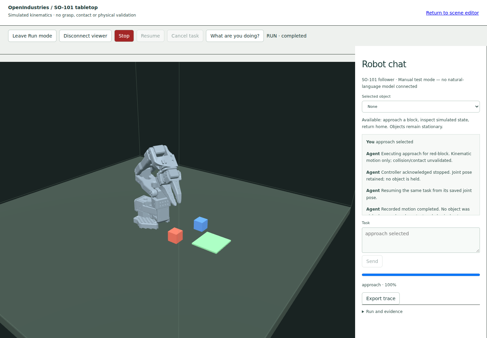

# Recorded local chat-to-motion execution

This is **manual test-mode execution**, not a live language-model run or contact-based
pick/place. The screenshot/video show the real workbench, pinned SO-101 meshes and
controller-owned motion. The blocks stay stationary throughout.

- Tested source: `2184358ef12de2485ebacc779be3e8f1b713daa2`.
- Exact implementation tree: `a4642e01c159750872d757350fec0d08192ea242`.
- Upstream geometry: `a758567c3978dfeefe282ede0500085a48fe8f78`, with all source-lock hashes verified at startup.
- Environment: Ubuntu 24.04.3, Python 3.12.14, NumPy 2.3.5, SciPy 1.17.0, Node v24.22.1, Chromium with SwiftShader.
- Browser input: select `red-block`, enter Run mode, send `approach selected`, Stop,
  Resume, disconnect, reconnect, reload, then submit an ungrounded request.
- Observed UI Stop acknowledgement: **1,358 ms**, within the exercised 1.5-second
  browser bound. This includes automation, rendering and polling; it is not a hardware
  response-time claim. The direct-controller test separately bounds acknowledgement
  at 250 ms while inference can be pending.
- Final TCP error: approximately `2.06e-10 m` against the 3 mm tolerance. This is a
  computed kinematic postcondition; contact and physical validity remain false.

[Short recorded demonstration](demo.mp4) · [Correlated request/task/command/observation trace](browser-checks.json) · [File hashes](checksums.json)

The WebM produced by Playwright was re-encoded to MP4 at 960-pixel width/12 fps and
trimmed by one second at the start. Robot execution is not sped up or synthesized.
The original test artifacts are uploaded by the existing FIELD-LAB render CI job.

## Validation

Ten Python tests pass, covering the real configured HTTP policy transport with an
**explicit test double**, durable controller state, three target-dependent IK solutions,
unknown/ambiguous targets, forbidden manipulation proposals, target changes before
dispatch, direct Stop overtaking inference, receipt replay, hard SIGKILL/restart of the
actual HTTP process, same-run recovery and no-client progress. The follow-up quota test
ensures Stop/Cancel remain available after ordinary request capacity is exhausted.

The actual built-browser test passed: authenticated local session, foreign-origin denial,
chat intent → Python authority → IK/controller → live workbench, Stop/Resume, disconnected
progress, retained run/task/conversation, evidence export data and no browser exceptions.
Application build/type checks, portable project-file tests, authored-animation tests and
existing FIELD-LAB browser regression checks also passed.

The provider-shaped HTTP test proves transport, proposal validation and observed result
handling. It does not prove that a real language model grounds or plans correctly.
No model endpoint/model name or local Ollama executable was configured in this environment;
no live-model result is claimed. The service can use an operator-configured local endpoint
without cloud credentials. See [setup and boundaries](../../embodied-chat.md).

## Still open in #54

A separately recorded live-model session, multi-step feedback planning, camera/sensor
observations, full-link collision checking, open/close/pick/place skills and contact-based
lift/retention/release/settled-placement verification remain. The included approach/home
paths do not satisfy those manipulation acceptance scenarios. The optional user systemd
unit's real login/reboot behavior was not exercised in this container. Keep the epic open.
