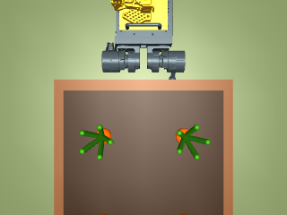
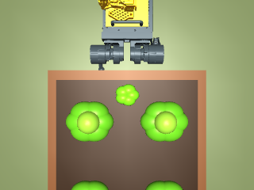
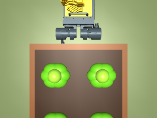
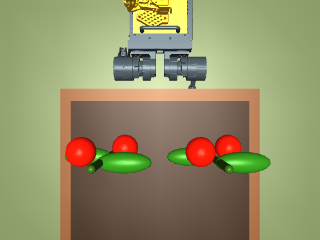
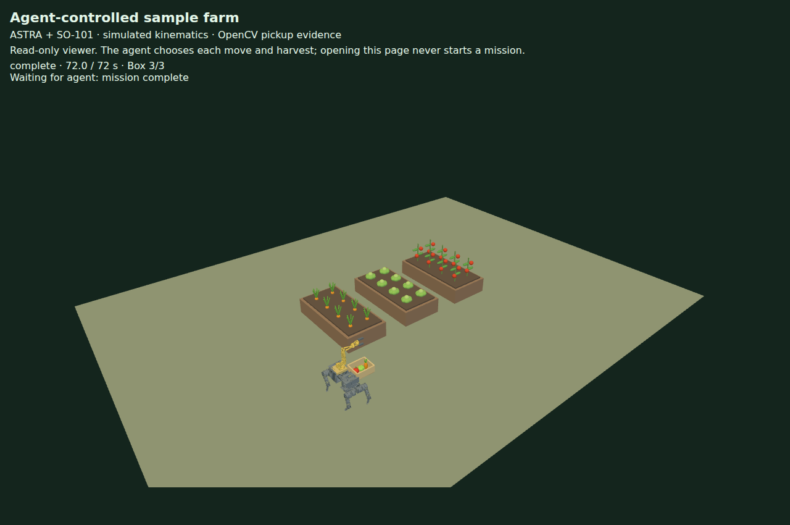

# Actual agent-controlled sample-farm run on AWS

On **2026-10-27 UTC**, the OpenCode assistant (**openai/gpt-6-astra**) directly used
the newly connected `farm` MCP server to operate the original ASTRA + SO-101 sample
farm on EC2 `i-0fc59dacd62a60f0a`, `us-east-1`.

This was a **model-issued tool run**, distinct from the local deterministic
`farm_evidence` verification. The assistant read the farm state and rendered images,
selected each permitted action, and checked each job's result. The model did not
generate joint trajectories: the original joint-limited kinematic segments execute
the movement. Grasp attachment and release remain scripted simulation effects.

## Versions and outcome

- OI application commit: `22a9cf13524bf4759c1bfe0603b0828aa8e1709e`.
- Original farm source: `523d1f5a54b5b279d6d2ae9fcb8b5315b15573aa`.
- MuJoCo 3.17.0, OpenCV 5.0.0, CPU/software EGL rendering.
- Seven completed jobs: move, harvest carrots, move, harvest lettuce, move,
  harvest tomato, return home.
- Nine immutable command receipts, including pause and resume.
- Same initial movement command was retried without duplicating the job.
- Final state: all three simulated produce items deposited, robot home,
  no active job, no review required.
- systemd restart and an independent SSH MCP reconnection preserved the same
  terminal station state and all seven job records (`verified-restart.json`).

| Bed | Label from sample scene | OpenCV pickup pixels before → after |
| --- | --- | --- |
| 2 | Carrots | 126 → 0 |
| 1 | Lettuce | 618 → 0 |
| 0 | Tomatoes | 436 → 0 |

The measurements are color evidence at a fixed simulated pickup ROI, not semantic
crop recognition or evidence of physical grasping. The background decorative plants
stay in the scene; one modeled harvest item per bed is moved into the collection box.

| Before | After |
| --- | --- |
|  |  |
|  |  |
|  |  |

`agent-run.json` contains the allowlisted persisted command requests/receipts, job
records, original frame hashes, OpenCV observations, final station state and IMDSv2
instance identity. It is an export of authoritative runtime records, not a transcript
of every read-only MCP call. The model/host label records the actual implementation
session that issued the shown commands. Private bearer tokens were excluded and
checked before export. `checksums.json` hashes the exported runtime artifacts.

## Separate deterministic verification

A separate local station was exercised through real stdio MCP using `farm_evidence`:
all three harvests, original PNG verification, idempotent retries before and after
completion, pause/resume, and a disconnect during an accepted movement all passed.
That automated run invoked no model. The full vision/MCP test suite passed **36 tests**,
including absent-target, stale-evidence/revision rejection, HTTP authorization and
paused in-flight restart tests. `npm run test:mcp`, locked dependency installation,
wheel installation, `pip check`, shell syntax and systemd unit syntax passed.

## Current deployment

Both the inspection and farm services run on the existing EC2 instance. The farm
uses `/opt/oi-farm/app`, `/opt/oi-farm/source`, and private `/var/lib/oi-farm/state`.
No additional instance or public API port was provisioned. Active work adds CPU
usage to the existing Unlimited-credit host. The recorded station remains at its
completed mission state; starting a fresh demonstration is an explicit operator action.

Connect via `ssh -T oi-inspection sudo -n /usr/local/bin/oi-farm-mcp`. The implementation
workstation has a viewer tunnel at `http://127.0.0.1:8795`; recreate it if needed with
`ssh -N -L 8795:127.0.0.1:8794 oi-inspection`.

See [setup, control contract and operation](../../farm-agent-control.md).
