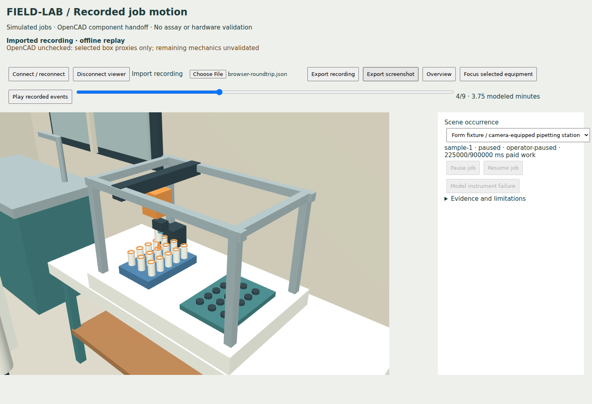

# FIELD-LAB runtime-scene verification

The screenshot shows the actual Three.js viewer at a recorded, paused SQLite job event.
The component pose is derived from 225,000 ms of paid work and the evaluated OpenCAD
handoff. The scene is explicitly labeled partially unchecked. It is not hardware evidence.

Verified locally with Node 24.22.1 and headless Chromium/SwiftShader:

- `npm run build` passed.
- `npm run test:simulation` passed all 112 tests.
- `npm run test:field-lab` matched all six frozen scenarios and restart/receipt evidence.
- `npm run test:field-lab-scene` passed recorded pose, controls, shortage, compaction,
  restart, authorization, source invalidation and portable replay checks.
- `npm run test:field-lab-scene-browser` passed both imported replay and a real local
  SQLite station, including independent progress while disconnected and live pause.
- `export-motion.py` ran against OpenCAD `9c0c6dc0b5794debdfb8c7507078bae3303dd8bd`:
  transfer samples/roundtrip, travel-limit rejection, misalignment rejection, and blocked-path
  collision detection passed. The overall baseline motion status remains **unchecked**
  because five component groups have no collision proxies.

The browser summary is in [browser-checks.json](browser-checks.json). The exact source
scene/Form hashes, OpenCAD revision, exporter hash, evaluated transforms, exceptions and
mechanics findings are in the [committed handoff](../../../benchmarks/field-lab/fixtures/pipette-motion.json).
Generated full recordings and captioned screenshots are CI artifacts, not runtime backups.
See [the contract](../../architecture/field-lab-scene.md) for reproduction and limits.
